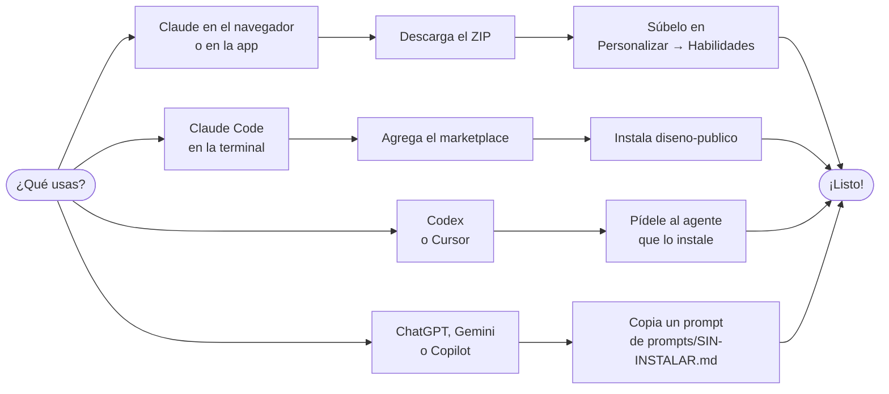

# Guía de instalación, paso a paso

No necesitas saber programar. Elige **un solo camino** y sigue los pasos en orden.

| Camino | Para quién | Qué necesitas | Tiempo |
|---|---|---|---|
| 🟢 **A. Claude en el navegador** | La mayoría. **Empieza aquí.** | Una cuenta de Claude (sirve la gratuita) | 5 minutos |
| 🔵 **B. Claude Code** | Quien ya usa Claude Code o quiere probarlo | Plan pago de Claude (Pro o superior) | 10 minutos |
| 🟣 **C. Codex o Cursor** | Quien trabaja con Codex (OpenAI) o con el editor Cursor | Codex o Cursor instalado | 3 minutos |
| ⚪ **D. Sin instalar nada** | Quien usa ChatGPT, Gemini o Copilot en el chat | Cualquier chat de IA | 1 minuto |



> **Antes de empezar, dos reglas del curso:**
> 1. **Nunca pegues datos personales reales** (cédulas, nombres de ciudadanos,
>    teléfonos, direcciones) en ninguna IA. Usa datos ficticios.
> 2. Todo lo que produzca la IA **se revisa** antes de usarse en la entidad.

---

## 🟢 Camino A: Claude en el navegador (recomendado)

Funciona en [claude.ai](https://claude.ai) y en la aplicación de escritorio de Claude.

### Paso 1. Descarga la habilidad

Haz clic en la que quieras. El archivo `.zip` se descarga solo. **No lo
descomprimas.**

| Habilidad | Para qué | Descarga |
|---|---|---|
| ⭐ **pieza-ciudadana** | Crear una página para explicar un trámite o una política | [pieza-ciudadana.zip](https://github.com/jordansrojas1/estudio-ia-publica/raw/main/descargas/pieza-ciudadana.zip) |
| **auditar-diseno** | Revisar si una página se lee bien y si sus animaciones están ordenadas | [auditar-diseno.zip](https://github.com/jordansrojas1/estudio-ia-publica/raw/main/descargas/auditar-diseno.zip) |
| **referencias-visuales** | Aprender de sitios bien diseñados | [referencias-visuales.zip](https://github.com/jordansrojas1/estudio-ia-publica/raw/main/descargas/referencias-visuales.zip) |

Si es tu primera vez, empieza solo con **pieza-ciudadana**.

### Paso 2. Activa la ejecución de código

1. Entra a [claude.ai](https://claude.ai) con tu cuenta.
2. Abre **Configuración** (Settings) → **Capacidades** (Capabilities).
3. Activa **Ejecución de código y creación de archivos** (Code execution and file creation).

> Las habilidades necesitan esta opción. Sin ella, no aparecen.

### Paso 3. Sube la habilidad

1. Ve a **Personalizar** (Customize) → **Habilidades** (Skills).
2. Haz clic en **+** → **Crear habilidad** (Create skill) → **Subir una habilidad** (Upload a skill).
3. Elige el `.zip` que descargaste en el paso 1.
4. La habilidad aparece en tu lista. Comprueba que esté **activada**.

Repite el paso 3 con cada `.zip` que quieras sumar.

> Los nombres de los menús pueden cambiar con el tiempo. Si no los encuentras,
> mira la [guía oficial de Anthropic sobre habilidades](https://support.claude.com/en/articles/12512180-use-skills).

### Paso 4. Pruébala

Abre un chat nuevo y pega esto:

```
Usa la habilidad pieza-ciudadana para crear una página que explique, en lenguaje
claro, cómo pedir un certificado de residencia en una alcaldía ficticia llamada
Villa Esperanza. Público: adultos mayores.
```

Claude te devuelve un archivo `.html`. Descárgalo y ábrelo con **doble clic**: se
abre en tu navegador. 🎉

---

## 🔵 Camino B: Claude Code

Claude Code requiere un plan **Pro, Max, Team o Enterprise** (el plan gratuito no
lo incluye).

### Paso 1. Instala Claude Code (si aún no lo tienes)

Abre la terminal:
- **Mac**: presiona `Cmd + Espacio`, escribe *Terminal* y presiona Enter.
- **Windows**: abre el menú Inicio, escribe *PowerShell* y presiona Enter.

Copia y pega el comando de tu sistema, y presiona Enter:

**Mac o Linux**
```bash
curl -fsSL https://claude.ai/install.sh | bash
```

**Windows (PowerShell)**
```powershell
irm https://claude.ai/install.ps1 | iex
```

Cierra la terminal, ábrela de nuevo y escribe `claude`. La primera vez te pide
iniciar sesión en el navegador.

> ¿Prefieres no usar la terminal? La **aplicación de escritorio de Claude** trae
> Claude Code en su pestaña *Code*. Guía oficial: https://code.claude.com/docs/en/setup

### Paso 2. Agrega este kit

Dentro de Claude Code, escribe estas dos líneas, una por una:

```
/plugin marketplace add jordansrojas1/estudio-ia-publica
```

```
/plugin install diseno-publico@estudio-ia-publica
```

Si Claude Code te pregunta si confías en el marketplace, responde que sí.

### Paso 3. Pruébalo

Escribe:

```
/diseno-publico:pieza-ciudadana Crea una página que explique cómo pedir un
certificado de residencia en una alcaldía ficticia llamada Villa Esperanza.
```

Y después, para revisar lo que acabas de crear:

```
/diseno-publico:auditar-diseno Revisa la página que acabas de crear y dime, en
lenguaje sencillo, si todo el texto se lee bien.
```

### Para actualizar el kit más adelante

```
/plugin marketplace update estudio-ia-publica
```

---

## 🟣 Camino C: Codex o Cursor

Codex (OpenAI) y Cursor leen las habilidades de la **misma carpeta estándar**:
`~/.agents/skills` (en Windows, `C:\Users\TU-USUARIO\.agents\skills`). Basta con poner
ahí las tres carpetas del kit y sirven para los dos.

Elige **una** de estas tres formas. La primera no requiere tocar la terminal.

### Opción 1 (la más fácil): pídeselo al agente

Abre **Codex** (en la terminal, en la extensión de VS Code o Cursor, o en la app de
escritorio) o el **chat de Agente de Cursor**, y pega esto:

```
Instala en mi computador las habilidades del kit
https://github.com/jordansrojas1/estudio-ia-publica
Copia cada carpeta que está dentro de plugins/diseno-publico/skills/
(pieza-ciudadana, auditar-diseno y referencias-visuales) en la carpeta
.agents/skills de mi carpeta de usuario. Créala si no existe. Si ya hay una
carpeta con el mismo nombre, no la borres: pregúntame primero.
Al terminar, dime qué quedó instalado y en qué ruta.
```

El agente te pedirá permiso para descargar y copiar archivos: acéptalo.

### Opción 2: un solo comando

Abre la terminal (Mac: `Cmd + Espacio` → *Terminal*; Windows: Inicio → *PowerShell*),
pega el comando de tu sistema y presiona Enter.

**Mac o Linux**
```bash
curl -fsSL https://raw.githubusercontent.com/jordansrojas1/estudio-ia-publica/main/instalar.sh | bash
```

**Windows (PowerShell)**
```powershell
irm https://raw.githubusercontent.com/jordansrojas1/estudio-ia-publica/main/instalar.ps1 | iex
```

El instalador ([`instalar.sh`](instalar.sh) / [`instalar.ps1`](instalar.ps1)) es
corto y puedes leerlo antes: solo descarga el kit y copia las tres carpetas. Si ya
tenías una carpeta con el mismo nombre, no la borra: la guarda en
`.agents/skills-respaldo`. Para actualizar el kit, vuelve a correr el mismo comando.

### Opción 3: a mano

1. Descarga [el kit completo en ZIP](https://github.com/jordansrojas1/estudio-ia-publica/archive/refs/heads/main.zip) y descomprímelo.
2. Entra a `plugins/diseno-publico/skills/`.
3. Copia las tres carpetas (`pieza-ciudadana`, `auditar-diseno`, `referencias-visuales`)
   dentro de la carpeta `.agents/skills` de tu usuario. Si no existe, créala.
   Es una carpeta oculta: en Mac presiona `Cmd + Shift + .` para verla; en Windows,
   en el Explorador, activa *Vista → Mostrar → Elementos ocultos*.

### Pruébalo

Cierra y vuelve a abrir Codex o Cursor. Luego:

| Herramienta | Cómo llamar la habilidad |
|---|---|
| **Codex** | Escribe `$pieza-ciudadana` (o `/skills` para ver la lista) y tu pedido |
| **Cursor** | En el chat de **Agente**, escribe `/pieza-ciudadana` y tu pedido |

Por ejemplo:

```
$pieza-ciudadana Crea una página que explique cómo pedir un certificado de
residencia en una alcaldía ficticia llamada Villa Esperanza. Público: adultos mayores.
```

El agente crea el archivo `.html` en tu carpeta de trabajo. Ábrelo con doble clic.

> También puedes no nombrarla: si pides "haz una página para explicar este trámite",
> Codex y Cursor eligen la habilidad solos cuando el pedido coincide con su descripción.

> **Equipos en Cursor (planes Teams o Enterprise):** el repositorio también trae
> `.cursor-plugin/marketplace.json`, así que un administrador puede importarlo como
> marketplace del equipo desde el panel de Cursor (*Plugins & MCPs → Add Marketplace →
> Import from Repo*).

Guías oficiales: [habilidades en Codex](https://learn.chatgpt.com/docs/build-skills) ·
[habilidades en Cursor](https://cursor.com/docs/skills).

---

## ⚪ Camino D: sin instalar nada

Abre [`prompts/SIN-INSTALAR.md`](prompts/SIN-INSTALAR.md), copia el prompt que
quieras y pégalo en ChatGPT, Gemini, Copilot o Claude. Funciona igual de bien para
practicar; solo pierdes las mediciones automáticas de contraste.

---

## ¿Algo salió mal?

| Me pasa esto | Haz esto |
|---|---|
| No veo **Habilidades** en el menú | Activa *Ejecución de código* (Camino A, paso 2) y recarga la página |
| Al subir el ZIP sale un error | No lo descomprimas ni lo renombres. Descárgalo de nuevo desde el enlace |
| Claude no usa la habilidad | Nómbrala en tu mensaje: "Usa la habilidad pieza-ciudadana para…" |
| `claude` no se reconoce en la terminal | Cierra y vuelve a abrir la terminal. Si sigue, mira la guía oficial de instalación |
| Codex o Cursor no ven la habilidad | Cierra y abre de nuevo la aplicación. Revisa que exista `.agents/skills/pieza-ciudadana/SKILL.md` en tu carpeta de usuario (no una carpeta de más en medio) |
| En Cursor no aparece al escribir `/` | Usa el chat en modo **Agente**, no en modo *Ask* |
| Windows dice que no puede ejecutar scripts | Usa la Opción 1 (pídeselo al agente) o la Opción 3 (a mano) |
| El `.html` se ve como texto raro | Guárdalo con extensión `.html` y ábrelo con Chrome, Edge, Firefox o Safari |
| Dice que falta Python | Solo afecta las mediciones automáticas. Pide a Claude que calcule el contraste "a mano", o instala Python desde https://www.python.org |

¿Sigues con dudas? Pregunta en el grupo del curso o escríbele al profesor.
