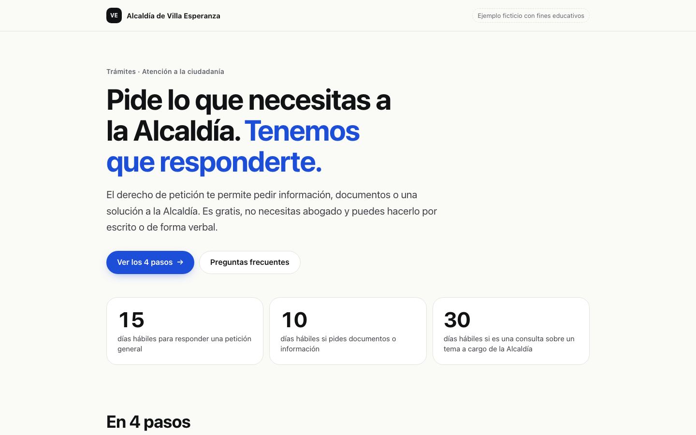
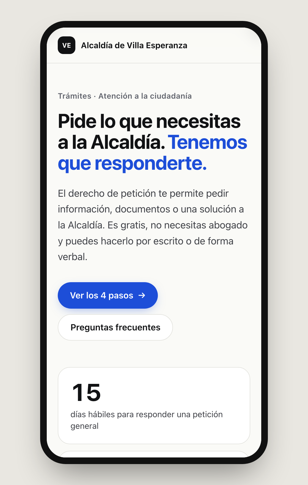
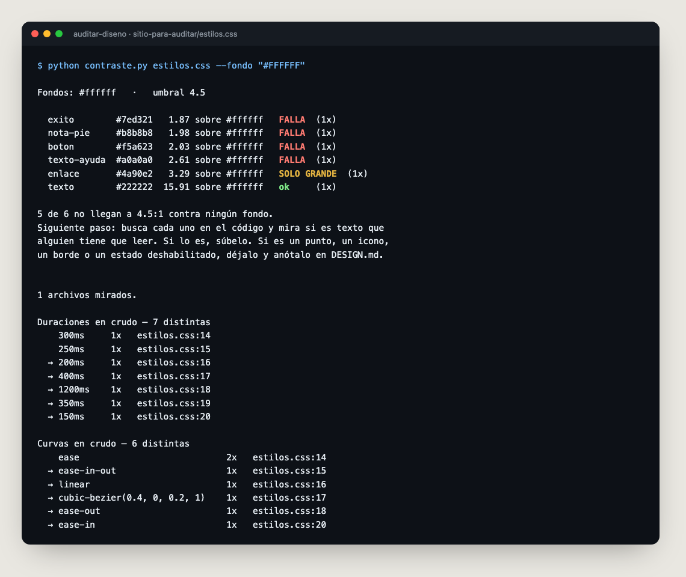

# estudio-ia-publica

**Kit de diseño con IA para la gestión pública.** Tres habilidades para Claude que
te ayudan a crear páginas claras, accesibles y con buen movimiento para la
ciudadanía, y a revisar si las que ya existen se leen bien.

> Versión light del estudio de diseño de **Jordan Rojas**, preparada para las y los
> estudiantes del curso *IA Generativa para la Gestión Pública* · Universidad de los
> Andes · Escuela de Gobierno Alberto Lleras Camargo · 2026.

**🌐 Versión ABC en la web:** https://aprendeia.jordanrojas.com/modulos/iagp-2026/kit-diseno

---

## ¿Qué puedes lograr?

### 1. Explicar un trámite en una página que da gusto leer

Le das el trámite a Claude y te devuelve **un solo archivo** que se abre con doble
clic: titular claro, cifras que cuentan solas, pasos que aparecen al bajar, lista de
chequeo y preguntas frecuentes. Accesible y lista para el celular.



<p align="center">
  
</p>

👉 Ábrela tú: [`ejemplos/pieza-ciudadana-derecho-de-peticion.html`](ejemplos/pieza-ciudadana-derecho-de-peticion.html)
(descárgala y haz doble clic).

### 2. Saber, con números, si una página se lee bien

La Resolución 1519 de 2020 de MinTIC exige a las entidades cumplir **WCAG 2.1 AA**.
Esta habilidad mide el contraste de cada color de texto y cuenta cuántas velocidades
y curvas de animación hay. Así se ve sobre el sitio de práctica que trae el kit:



Claude lo traduce a un informe en lenguaje claro: qué cambiar, por qué y qué no hace
falta tocar.

### 3. Aprender de sitios bien diseñados, sin copiarlos

Referencias ya desarmadas (colores, letra, ritmo, movimiento) y un método para
analizar las tuyas, con su crédito.

### Más ideas para tu entidad

- 📋 El trámite más consultado, explicado en 4 pasos.
- 📊 La rendición de cuentas en una página: tres cifras que cuentan y lo que viene.
- 🏛️ Una política pública: el problema, la meta y qué cambia para la gente.
- ✅ Una convocatoria, con los requisitos como lista de chequeo.
- 🔍 Revisar el contraste del portal de tu entidad antes de un rediseño.

---

## Instalación en 3 pasos

👉 **Guía completa, con cada clic explicado: [GUIA-INSTALACION.md](GUIA-INSTALACION.md)**

**El camino más fácil (Claude en el navegador, sirve la cuenta gratuita):**

1. Descarga [pieza-ciudadana.zip](https://github.com/jordansrojas1/estudio-ia-publica/raw/main/descargas/pieza-ciudadana.zip). No lo descomprimas.
2. En [claude.ai](https://claude.ai): **Configuración → Capacidades**, activa *Ejecución de código*.
3. **Personalizar → Habilidades → + → Subir una habilidad**, y elige el ZIP.

**¿Usas Claude Code?**

```
/plugin marketplace add jordansrojas1/estudio-ia-publica
```

```
/plugin install diseno-publico@estudio-ia-publica
```

**¿Usas ChatGPT, Gemini o Copilot?** Copia un prompt de
[`prompts/SIN-INSTALAR.md`](prompts/SIN-INSTALAR.md).

---

## Qué trae

| Habilidad | Para qué | Pídele, por ejemplo… |
|---|---|---|
| ⭐ `pieza-ciudadana` | Crear una página accesible y animada para explicar un trámite, servicio o política | "Haz una página que explique cómo sacar el certificado de residencia" |
| `auditar-diseno` | Medir el contraste (WCAG 2.1 AA) y ordenar las animaciones de una página que ya existe | "¿Se lee bien esta página? Te pego el CSS" |
| `referencias-visuales` | Aprender de sitios bien diseñados sin copiarlos | "¿Por qué este sitio se ve tan bien? ¿Qué le sirve a mi entidad?" |

```
estudio-ia-publica/
├── GUIA-INSTALACION.md       ← empieza aquí
├── CREDITOS.md               ← quién hizo qué
├── descargas/                ← los ZIP para subir a claude.ai
├── prompts/SIN-INSTALAR.md   ← para ChatGPT, Gemini o Copilot
├── ejemplos/                 ← la página de ejemplo y un sitio para practicar
└── plugins/diseno-publico/   ← las habilidades (para Claude Code)
```

---

## Reglas del curso que este kit respeta

1. **Cero datos personales reales.** Ni cédulas, ni nombres de ciudadanos, ni teléfonos.
2. **Todo se revisa.** La IA propone; la persona servidora pública decide y verifica
   normas, plazos y canales antes de publicar.
3. **Accesibilidad no negociable.** Contraste AA y movimiento que se puede apagar.

---

## Créditos

**Autor del método y del kit:** Jordan Rojas.
**Desarrollo asistido por:** Claude (Anthropic), mediante Claude Code.
**Referencias analizadas:** Damir ([heydamir.design](https://heydamir.design)) y
lroy-stack ([admin-os](https://github.com/lroy-stack/admin-os), MIT).
**Normas y estándares:** W3C (WCAG 2.1), MinTIC (Resolución 1519 de 2020).

Detalle completo, cómo citar y qué se dejó fuera: **[CREDITOS.md](CREDITOS.md)**.

Este kit es material de apoyo del docente y **no es una publicación oficial de la
Universidad de los Andes**.

## Licencia

Código bajo [MIT](LICENSE). Contenidos bajo [CC BY 4.0](LICENCIA-CONTENIDO.md).
Úsalo, adáptalo y compártelo, **dando crédito**.
